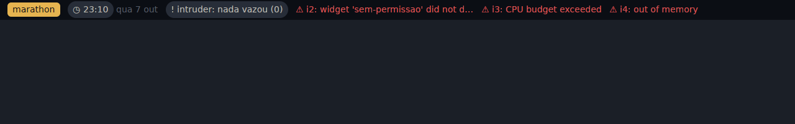

# marathon-spike

Spike da arquitetura "GPUI como Qt, Luau/TSX como QtQuick, serviços por Unix socket".
A pergunta que ele responde: dá para ter widgets escritos em **Luau ou TSX**, com
**sandbox de verdade**, alimentados por **serviços em qualquer linguagem**, sem
que o core precise saber de nenhum deles?

```
┌──────────────────────────────────────────────────────────┐
│ widgets/*  Luau ou TSX · sandbox · 1 thread + 1 VM cada   │
├──────────────────────────────────────────────────────────┤
│ runtime    núcleo reativo em Rust (signals, bindings)     │
│ view       vocabulário fechado: Row Column Text Icon      │
│            Pill Button Progress Spacer                    │
├──────────────────────────────────────────────────────────┤
│ shell      renderer GPUI (layer-shell) ou terminal        │
│ connector  dono de todos os sockets · multiplexa · reconecta│
├────────────────┬─────────────────┬───────────────────────┤
│ power (Go)     │ sys (Python)    │ <seu>.sock (qualquer)  │
└────────────────┴─────────────────┴───────────────────────┘
```




Capturas reais: sway headless + lavapipe, clique enviado por um ponteiro virtual
(perfil → "desempenho" passou por TSX → conector → serviço Go → re-render).
Build release sem GPUI: binário de 9 MB, ~11 MB de RSS com 4 widgets (2 Luau, 2 QuickJS).

## Rodando

```sh
./demo.sh                      # barra no terminal (←/→ foco, enter clica, ↑/↓ scroll, mouse funciona)
./demo.sh --headless --seconds 8 --click profile@3
./demo.sh --gpui               # barra GPUI em layer-shell (Wayland; ver abaixo)
./check.sh                     # testes + e2e sem display
```

Precisa de Rust, Go e Python 3. Edite qualquer arquivo em `widgets/` com a barra
aberta: o widget recarrega sozinho, sem perder as assinaturas dos outros.

Para o renderer GPUI no CachyOS: `sudo pacman -S wayland libxkbcommon vulkan-icd-loader`
e um compositor com `zwlr_layer_shell_v1` (niri, sway, river, KWin, Hyprland, Wayfire).

## Escrevendo um widget

Cada widget é uma pasta com `widget.toml` e um arquivo de entrada:

```toml
name = "battery"
entry = "battery.luau"      # .luau/.lua ou .tsx/.ts/.jsx/.js
uses = ["power"]            # serviços que o widget pode usar; o resto é negado
memory_mb = 16              # padrão 16
budget_ms = 50              # tempo de CPU por entrada no guest; padrão 50
```

Os dois estilos de reatividade funcionam nas duas linguagens:

```lua
-- Granular (estilo Solid/QML): só a prop que leu o signal re-executa.
local sys = use("sys")
local load = sys:subscribe("load")
return Progress { value = function() local v = load(); return v and v.ratio or 0 end }

-- Inteiro (estilo React): retornar uma função faz o widget todo virar um binding.
return function() local b = bat(); return Pill { label = b and b.percent .. "%" or "—" } end
```

```tsx
export default function Clock() {
  const clock = use("sys").subscribe<{ hm: string }>("clock");
  const seconds = signal(false);
  return <Pill icon="clock" label={() => clock()?.hm ?? "--:--"}
               active={seconds} onClick={() => seconds.update((s) => !s)} />;
}
```

Componentes TSX rodam **uma vez**; o que é reativo é função (`label={() => ...}`)
ou o próprio signal (`active={seconds}`). Handlers são `on_*` em Luau e `on*` em TSX.
Tipos para o editor: `widgets/marathon.d.ts` (com `widgets/tsconfig.json`) e
`widgets/marathon.d.luau` (luau-lsp `--definitions`).

## Escrevendo um serviço

Um serviço é um Unix socket em `$XDG_RUNTIME_DIR/marathon/services/<nome>.sock`
(ou `$MARATHON_SERVICES_DIR`) falando JSON por linha:

```
→ {"id":1,"op":"subscribe","path":"battery"}     ← {"id":1,"event":{...}}   (valor atual, depois cada mudança)
→ {"id":2,"op":"call","method":"x","args":{}}    ← {"id":2,"result":...} | {"id":2,"error":"..."}
→ {"id":3,"op":"get","path":"battery"}           ← {"id":3,"result":{...}}
→ {"id":4,"op":"unsubscribe","sub":1}            → {"id":5,"op":"describe"}
```

`sdk/go/marathon` e `sdk/python/marathon_service.py` implementam isso em ~200
linhas cada, sem dependências. Sockets fora do diretório entram por nome em
`[services]` no `marathon.toml`. Dá para testar um serviço na mão:
`socat - UNIX-CONNECT:run/services/power.sock` e digitar as linhas acima.

## O sandbox, camada por camada

| Camada | Como | Testado em |
|---|---|---|
| Sem autoridade ambiente | Luau em `sandbox(true)`, sem `require`/`loadstring`/`getfenv`; QuickJS sem `std`/`os`, sem loader de módulos (todo `import` falha), sem `fetch`/timers | `*_has_no_ambient_authority`, `js_cannot_import_anything` |
| Capacidades | `use(x)` falha se `x` não está em `uses`; o widget nunca abre socket — o core abre, por nome validado (`[a-z0-9_-]`, sem path traversal) | `undeclared_service_is_refused`, `rejects_path_like_service_names` |
| Prelúdio imutável | globais do Luau read-only; no JS, globais `writable:false, configurable:false`; ids de signal fora do alcance do guest | `prelude_is_read_only` |
| CPU | hook de interrupção dos dois motores contra um deadline por entrada (`budget_ms`) | `infinite_loops_are_interrupted`, `..._in_handler_..._widget_survives` |
| Memória | limite do alocador por VM (`memory_mb`) | `memory_bombs_are_contained` |
| Saída | árvore limitada (20k valores, profundidade 64) e só componentes do vocabulário | `huge_trees_are_rejected`, `unknown_components_are_rejected` |
| Isolamento de falha | uma thread e uma VM por widget; travou ou estourou, só ele vira ⚠ | `widgets/intruder` |

**O que o sandbox não cobre:** um bug de corrupção de memória dentro do próprio
QuickJS ou Luau (são C/C++). Para plugins de terceiros desconhecidos, o próximo
passo é rodar o motor dentro de wasmtime — a API vista pelo widget não muda.

`widgets/intruder` é um widget que tenta escapar de cada camada; adicione
`"intruder"` em `bar` e descomente uma tentativa por vez.

## Decisões e limites do spike

- **Reatividade no host.** Signals moram no Rust; o guest só chama `get/set`. Por
  isso Luau e TSX têm semântica idêntica e o rastreamento de dependências é um só.
  Bindings filhos, handlers e assinaturas pertencem ao binding que os criou e são
  descartados quando ele re-executa (teste `rebuilding_lists_does_not_leak`).
- **GPUI via `gpui-unofficial`** (republicação dos crates do Zed no crates.io, já
  com layer-shell). Para acompanhar o Zed direto, troque as duas dependências por
  `git = "https://github.com/zed-industries/zed"` em `crates/shell/Cargo.toml`.
- **Não há popups/OSD/control center** — só a barra. Cada um seria outra layer
  surface consumindo o mesmo vocabulário.
- **O serviço `power` simula** bateria e perfil quando não há `/sys/class/power_supply/BAT*`;
  um serviço real falaria com power-profiles-daemon via D-Bus.
- Ícones são glifos Unicode simples; um tema real mapearia nomes para Nerd Font/SVG.
